# Hong Kong e-Legislation (HKeL) errata: 15 verified textual errata, plus one drafting inconsistency

> **中文版：** [README.zh-CN.md](README.zh-CN.md)

> **Status — 26 November 2026.** Submitted to the Hong Kong Department of Justice
> (`elegislation-enq@doj.gov.hk`, cc `dojinfo@doj.gov.hk`) on 26 November 2026.
> Receipt was acknowledged by automated reply the same day. Awaiting a substantive
> response. This page will be updated if the Department responds or if any item is
> corrected.

> **Scope.** This repository publishes exactly what was submitted — 15 verified
> HKeL errata and one separate drafting inconsistency (16 items, 17 occurrences).
> Nothing else is published here.

## What this is

During an independent check of the Hong Kong e-Legislation dataset published on
DATA.GOV.HK, 15 clear-cut textual, numbering and punctuation errata were found in
the current consolidated text, plus one separate bilingual drafting inconsistency
in the Ordinance as enacted. All 16 items were submitted to the Department of
Justice on 26 November 2026. This repository publishes the submission in full —
the letter, the data file, and one evidence image per item — so that anyone can
check each item in under a minute.

Two of the items need a different kind of fix from the rest, and the submission
says so plainly:

- **P1-01** (Cap. 155L, s. 205(1)) is a substantive difference between the two
  language versions, not a typo. No correction is proposed unilaterally; the
  submission leaves it to the Department to consider referring it to the Law
  Drafting Division or the relevant policy or regulatory authority (such as the
  Hong Kong Monetary Authority).
- **S-01** (Cap. 571, Sch. 10, Pt. 1, s. 82(b)) is in the Ordinance as enacted
  (Ordinance No. 5 of 2002). It is not an HKeL transcription error and cannot be
  fixed by editing HKeL; it would require legislative amendment.

The other 14 items are unambiguous errors in the displayed text (and, in three
cases, in the underlying XML metadata as well). Each is listed below with its
evidence image and suggested correction.

## Items at a glance

| ID | Provision | What is wrong | Evidence | Status |
|----|-----------|---------------|----------|--------|
| P1-01 | Cap. 155L, s. 205(1) | EN "not more than one year" vs TC 「不足一年」 — the versions differ at the one-year endpoint | [P1-01.svg](evidence/P1-01.svg) | Open |
| P2-01 | Cap. 369AD, Sch. 5, Pt. 1, para. 16(5) | "250 metres of more" for "250 metres or more" | [P2-01.svg](evidence/P2-01.svg) | Open |
| P2-02 | Cap. 123I, s. 7A(1)(c) | Both subparagraphs numbered "(i)"; second should be "(ii)" | [P2-02.svg](evidence/P2-02.svg) | Open |
| P2-03 | Cap. 514, s. 144A(2)(e) | Both subparagraphs "(i)"; second should be "(ii)" — displayed text and XML metadata | [P2-03.svg](evidence/P2-03.svg) | Open |
| P2-04 | Cap. 374E, s. 57(3)(a) | Subparagraphs "(i), (ii), (ii)"; third should be "(iii)" — displayed text and XML metadata | [P2-04.svg](evidence/P2-04.svg) | Open |
| P2-05 | Cap. 132AK, s. 3(1) and s. 3(3) | Paragraphs "(a), (a)" in both subsections; second should be "(b)" — displayed text and XML metadata | [P2-05.svg](evidence/P2-05.svg) | Open |
| P2-06 | Cap. 511, s. 56(1)(l) | "(1)" (digit one) between "(k)" and "(m)"; should be "(l)" | [P2-06.svg](evidence/P2-06.svg) | Open |
| P2-07 | Cap. 112, s. 17A(1) | Extra "(" — "((普通股權一級資本票據)" | [P2-07.svg](evidence/P2-07.svg) | Open |
| P2-08 | Cap. 155S, s. 84(1) | "(第571章》" — "》" for ")" | [P2-08.svg](evidence/P2-08.svg) | Open |
| P2-09 | Cap. 161, Sch. 6, Pt. 1, s. 1 | Missing "(" before "pre-amended Disciplinary Regulation)" | [P2-09.svg](evidence/P2-09.svg) | Open |
| P2-10 | Cap. 4A, Order 69, r. 1 | Extra ")" — "內地 (Mainland))" | [P2-10.svg](evidence/P2-10.svg) | Open |
| P2-11 | Cap. 622, s. 114(3) | Missing "(" — "registered number註冊人數)" | [P2-11.svg](evidence/P2-11.svg) | Open |
| P2-12 | Cap. 4A, Order 117A, r. 23 (heading) | Missing ")" — "section 6(1 (O. 117A, r. 23)" | [P2-12.svg](evidence/P2-12.svg) | Open |
| P2-13 | Cap. 136, s. 70(2) | Extra ")" after the amendment note | [P2-13.svg](evidence/P2-13.svg) | Open |
| P2-14 | Cap. 374, s. 131(1)(m) | Missing "(" — "the fees if any) payable" | [P2-14.svg](evidence/P2-14.svg) | Open |
| S-01 | Cap. 571, Sch. 10, Pt. 1, s. 82(b) | "(a)款" for paragraph (a) — in the Ordinance as enacted; needs legislation, not an HKeL edit | [S-01.svg](evidence/S-01.svg) | Open |

"Open" means reported on 26 November 2026 and not yet confirmed corrected.
Items will be marked "Fixed" here with the date if and when they are corrected.

## The items in detail

In each image, the defect is highlighted in red; where the other language version
shows the correct form, it is highlighted in green. All excerpts are verbatim
from the snapshot XML (see [Method](#method)).

### P1-01 — Cap. 155L, s. 205(1): bilingual boundary discrepancy

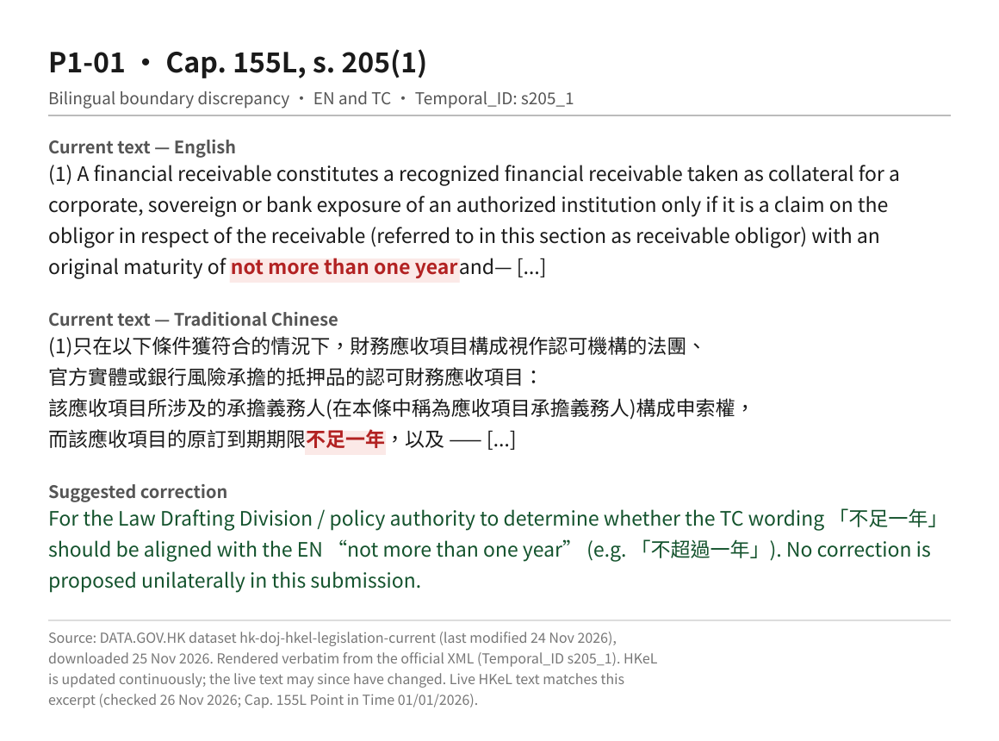

English: "not more than one year" (≤ 1 year, inclusive of exactly one year).
Traditional Chinese: 「不足一年」 (< 1 year, exclusive of exactly one year).
The two versions differ by exactly the one-year endpoint — the Traditional
Chinese wording is stricter than the English wording (and stricter than the
Basel standard, which expresses the same ≤ 1-year boundary as "less than or
equal to one year"). It affects only receivables whose original maturity is
exactly one year. No correction is proposed unilaterally; the submission asks
the Department to consider referring the matter to the Law Drafting Division
or the relevant policy or regulatory authority. Live HKeL text matches this
excerpt (checked 26 November 2026).

### P2-01 — Cap. 369AD, Sch. 5, Pt. 1, para. 16(5): "250 metres of more"

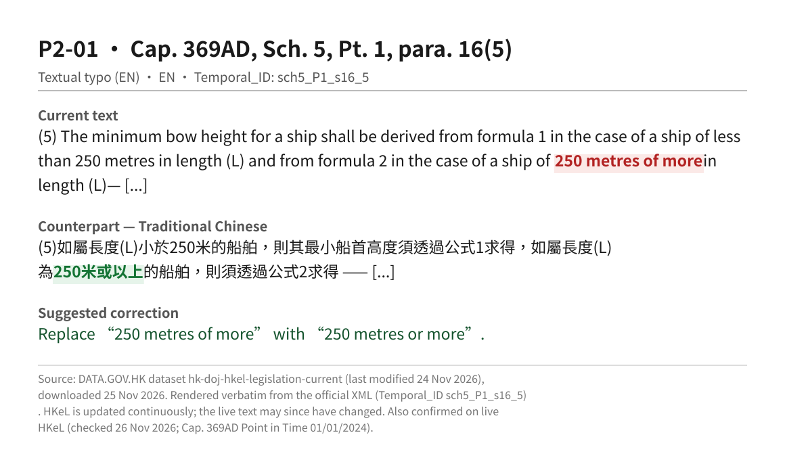

The English text reads "250 metres of more" where it should read "250 metres
or more". The parallel structure (formula 1 for ships under 250 m, formula 2
for ships of 250 m or more) and the correct Traditional Chinese 「250米或以上」
confirm the intended meaning. The error is present in all six past English
versions back to 30 June 1997 — the original version of this Regulation —
uncorrected for about 29 years. Also confirmed on live HKeL (checked
26 November 2026).

### P2-02 — Cap. 123I, s. 7A(1)(c): two "(i)" subparagraphs

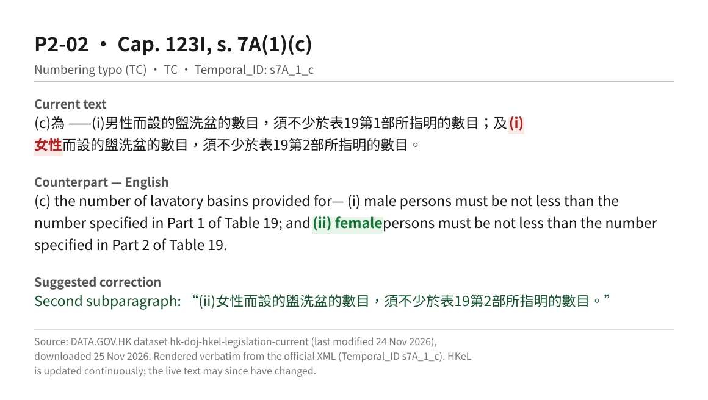

Both subparagraphs under the Traditional Chinese s. 7A(1)(c) display "(i)";
the second should be "(ii)". The English counterpart is correct, and the
Traditional Chinese XML `<num value>` is correct ("ii") — only the displayed
text is wrong.

### P2-03 — Cap. 514, s. 144A(2)(e): two "(i)" subparagraphs

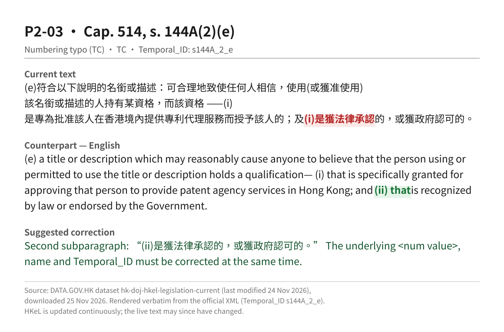

Both subparagraphs display "(i)"; the second should be "(ii)". Here the
underlying XML metadata are wrong as well as the displayed text: the second
subparagraph has `<num value>` "1", name "1" and Temporal_ID `s144A_2_e_1`,
duplicated from the first. Correction must cover the metadata as well as the
displayed text.

### P2-04 — Cap. 374E, s. 57(3)(a): "(i), (ii), (ii)"

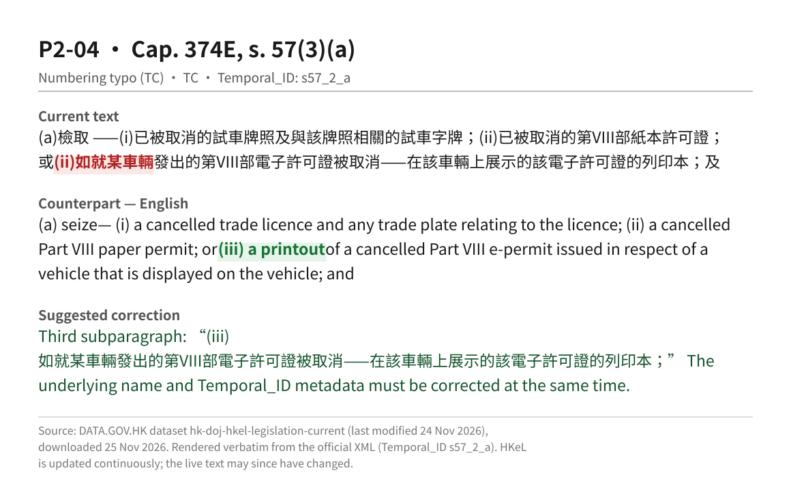

The subparagraphs display "(i), (ii), (ii)"; the third should be "(iii)".
The underlying XML metadata are likewise wrong: the third subparagraph
duplicates the second subparagraph's name ("2") and Temporal_ID
(`s57_2_a_2`). Note also that the three (a) paragraphs in s. 57(2),
s. 57(2A) and s. 57(3) share the Temporal_ID `s57_2_a` — a legacy identifier
in the Traditional Chinese XML (the subsection's `<num value>` is likewise
"2" although the displayed number is "(3)"). The provision reference
s. 57(3)(a) follows the displayed text, confirmed against the English XML
(`s57_3_a`).

### P2-05 — Cap. 132AK, s. 3(1) and s. 3(3): two "(a)" paragraphs, twice

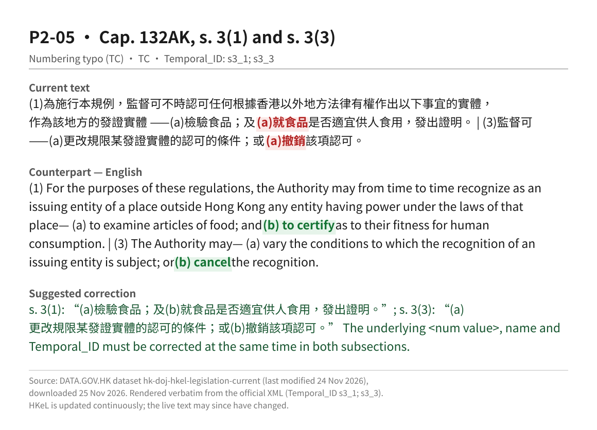

In both s. 3(1) and s. 3(3) the paragraphs display "(a), (a)"; in each place
the second should be "(b)". Two occurrences of the same error in one section.
The underlying XML metadata are likewise wrong in both subsections: the
second paragraph has `<num value>` "a", name "a" and Temporal_ID `s3_1_a`
(s. 3(1)) / `s3_3_a` (s. 3(3)), duplicated from the first. Correction must
cover the metadata as well as the displayed text, in both subsections.

### P2-06 — Cap. 511, s. 56(1)(l): "(1)" for "(l)"

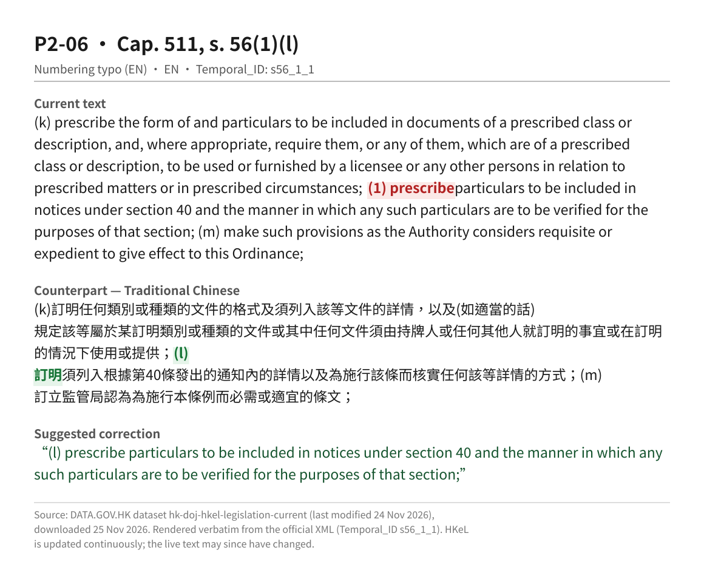

In the English (a)–(n) letter list, one item displays "(1)" (digit one)
between "(k)" and "(m)"; it should be "(l)" (letter L). The Traditional
Chinese correctly displays "(l)". Note: the English XML Temporal_ID of the
defective paragraph is `s56_1_1` (digit "1", as displayed); the Traditional
Chinese counterpart paragraph is `s56_1_l`.

### P2-07 — Cap. 112, s. 17A(1): extra "(" in a defined term

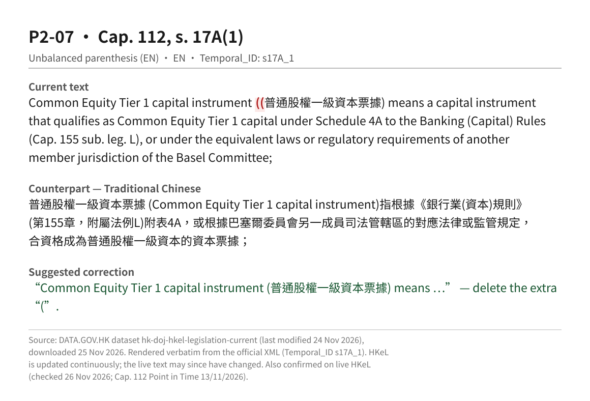

The English defined term opens with two "(" and closes with one ")":
"((普通股權一級資本票據)". It should read "(普通股權一級資本票據)".
Present since the provision was added (12 of 2016, s. 14; first version
3 June 2016), about 10 years uncorrected. Also confirmed on live HKeL
(checked 26 November 2026; live version 13 November 2026).

### P2-08 — Cap. 155S, s. 84(1): "(第571章》"

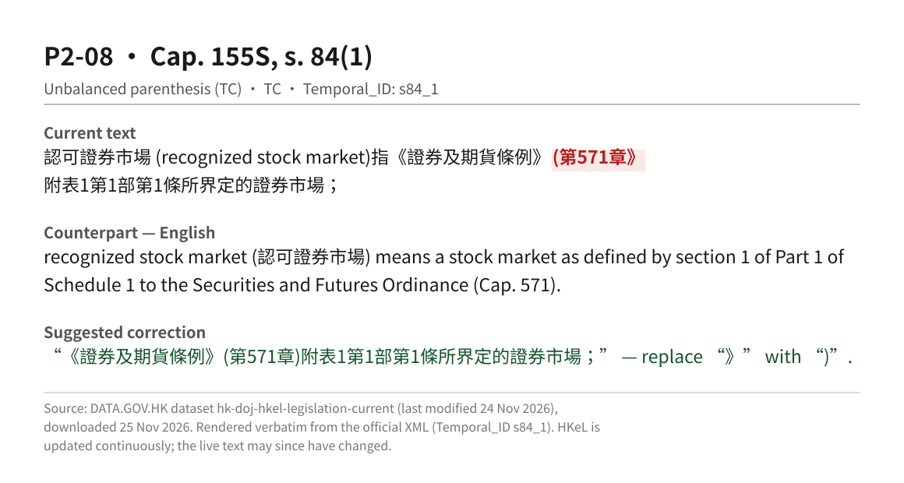

The Traditional Chinese text closes the parenthesis with a full-width "》"
instead of ")": "(第571章》" should read "(第571章)". The English is balanced.

### P2-09 — Cap. 161, Sch. 6, Pt. 1, s. 1: missing "("

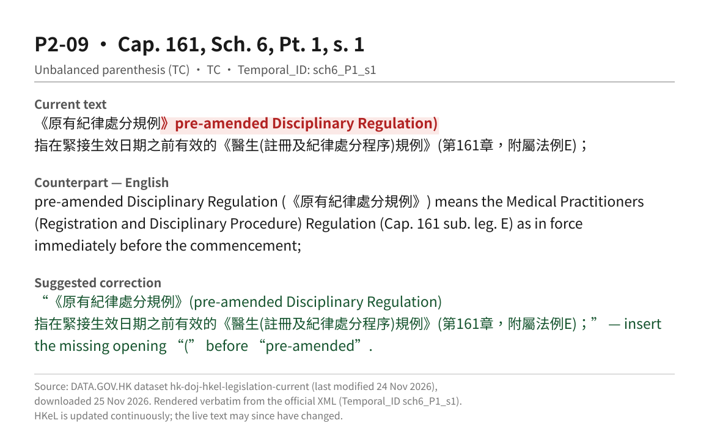

The English gloss for 《原有紀律處分規例》 is missing its opening "(" —
rendered "pre-amended Disciplinary Regulation)". The two neighbouring
definitions have complete parentheses.

### P2-10 — Cap. 4A, Order 69, r. 1: extra ")"

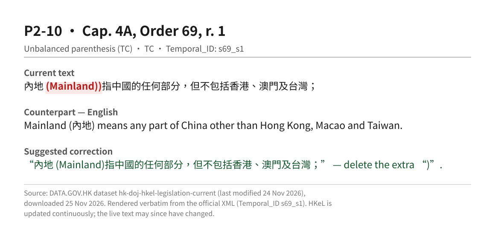

The Traditional Chinese reads "內地 (Mainland))" — two ")" for one "("; the
extra ")" sits inside the `<term>` text "Mainland)". The English "Mainland
(內地)" is balanced.

### P2-11 — Cap. 622, s. 114(3): missing "("

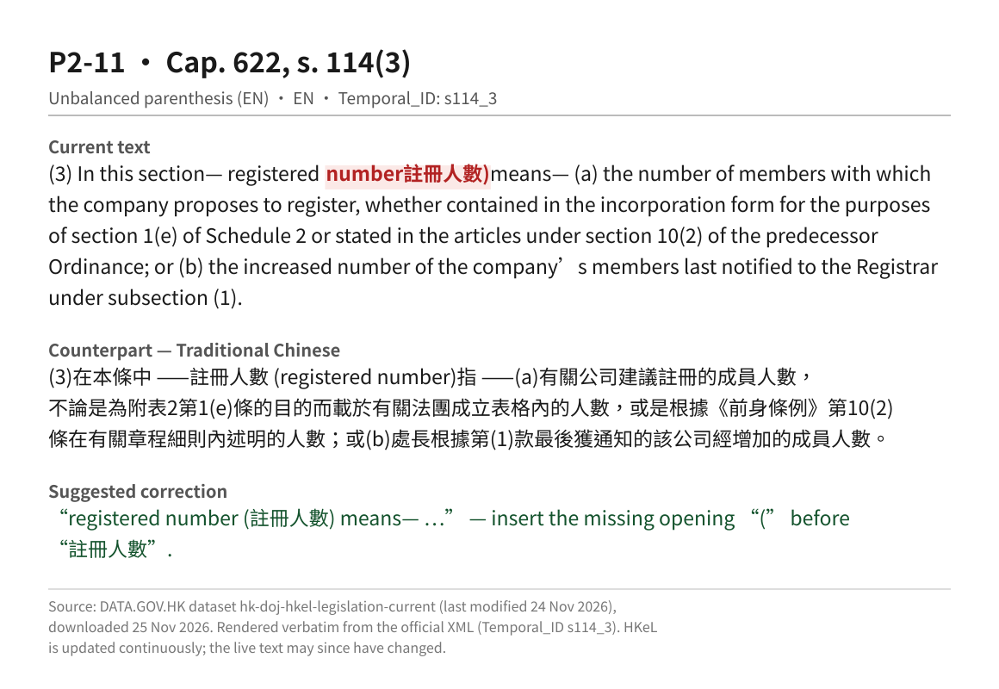

The definition opens "registered number" and the Chinese gloss is missing
its opening "(" — rendered "registered number註冊人數)". It should read
"(註冊人數)".

### P2-12 — Cap. 4A, Order 117A, r. 23 (heading): missing ")"

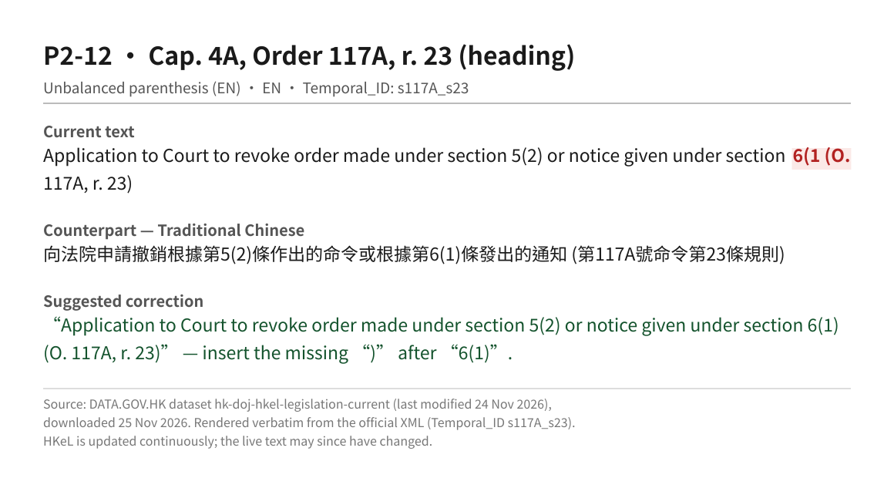

The rule heading reads "section 6(1 (O. 117A, r. 23)" — "6(1" is missing
its closing ")". It should read "section 6(1)".

### P2-13 — Cap. 136, s. 70(2): extra ")" after the amendment note

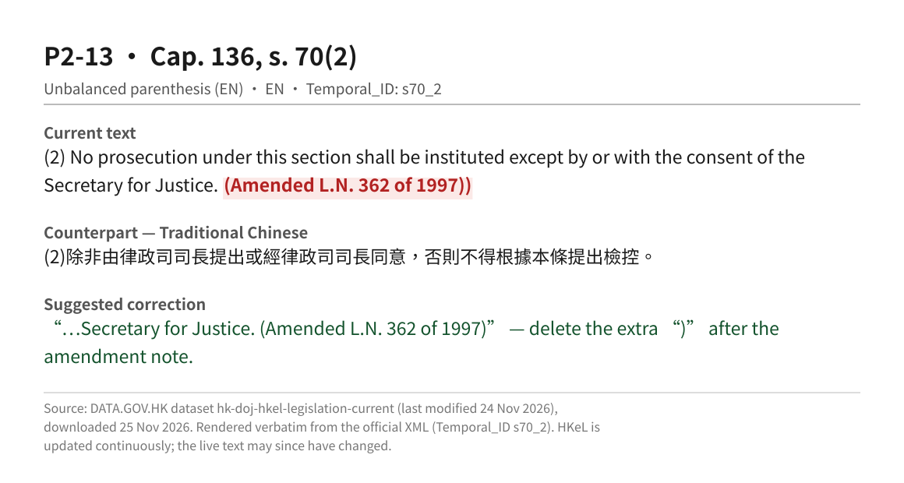

An extra ")" follows the amendment note: "…Secretary for Justice. (Amended
L.N. 362 of 1997))". The stray ")" sits in the `<content>` text after the
(itself balanced) amendment note; it is not an error in the note itself.

### P2-14 — Cap. 374, s. 131(1)(m): missing "("

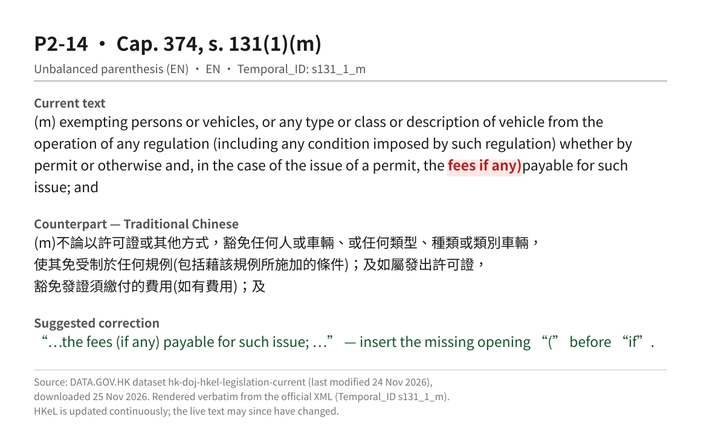

"…the fees if any) payable…" — an unmatched ")" after "any". The missing
character is the opening "(" before "if": "the fees (if any) payable". The
earlier "(including …" parenthesis in the same paragraph is already closed.

### S-01 — Cap. 571, Sch. 10, Pt. 1, s. 82(b): "(a)款" for paragraph (a)

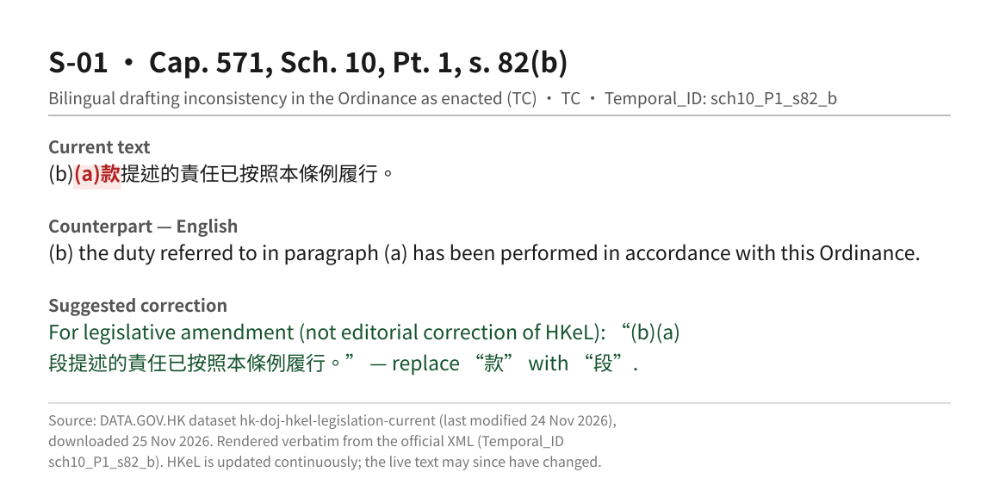

The Traditional Chinese writes "(a)款" ("subsection (a)"), but (a) is a
paragraph in both XML versions, and the English correctly says "the duty
referred to in paragraph (a)". The referent is unambiguous. This wording is
present in the Ordinance as enacted (Ordinance No. 5 of 2002, gazetted text),
not an HKeL transcription or digitisation error: the same Schedule, Pt. 1,
s. 79(c) uses 「段」 for a comparable reference. Correction therefore requires
legislative amendment, not editorial correction of HKeL.

## Method

This section describes the method only as far as is needed to check the items
above. No bulk data or extraction scripts are published with this report.

- **Source.** DATA.GOV.HK dataset `hk-doj-hkel-legislation-current` (last
  modified 24 November 2026), downloaded 25 November 2026 — the eight English
  and Traditional Chinese ZIP archives (the four Simplified Chinese archives
  were not used).
- **Checking.** Each item was checked in both language versions of the same
  provision in the snapshot XML, located by its `Temporal_ID`; the excerpts in
  the CSV are verbatim from that XML. Only items that are unambiguous in the
  current consolidated text were kept.
- **Live spot-checks.** Cap. 112, s. 17A(1) and Cap. 369AD, Sch. 5, Pt. 1,
  para. 16(5) were confirmed on live HKeL, and the Cap. 155L, s. 205(1) live
  text was confirmed to match the snapshot (checked 26 November 2026). Live
  HKeL is updated continuously, so the live text of any item may since have
  changed; the snapshot is the reference for this report.
- **Reproduction.** Open the chapter link in the CSV, find the provision
  cited; or open the DATA.GOV.HK XML for the chapter and search for the
  `Temporal_ID` given in the CSV. Each item is meant to be checkable by hand
  in under a minute.
- **Limits.** The snapshot is dated 24/25 November 2026. The P1 item is a
  substantive difference between the two language versions, not a typo, and no
  correction is proposed for it unilaterally. The S-01 item is in the Ordinance
  as enacted and needs legislation, not an edit.

## What is not in this repository

- Nothing beyond the 16 items in the submission letter.
- No correspondence with the Department beyond the submission letter itself
  (receipt was acknowledged by automated reply on 26 November 2026; the
  acknowledgement is not reproduced here).
- No claims about any other chapter or provision.

## Files

- `HKeL_Verified_Errata_16_Final_2026-11-26.csv` — the submitted data file:
  16 items with bilingual excerpts, suggested corrections, issue descriptions
  and XML `Temporal_ID` locations (UTF-8 with BOM, CRLF line endings).
- `submission/` — the submission letter exactly as sent (HTML).
- `evidence/` — one image per item, rendered verbatim from the snapshot XML
  with the defect highlighted in red (the correct counterpart form, where it
  proves the error, is highlighted in green). The rendering script is not
  published; the images are checkable against the CSV excerpts and the
  snapshot XML.

## Licence and attribution

- The text of this report is released under CC BY 4.0 (see `LICENSE`).
- Legislative text quoted in the evidence images and the CSV is from HKeL /
  DATA.GOV.HK and remains © Government of the Hong Kong Special Administrative
  Region. It is reproduced here for the purpose of reporting errors.
- Citation: Zhou Hegong, *HKeL errata: 15 verified textual errata, plus one
  drafting inconsistency* (submitted to the Hong Kong Department of Justice,
  26 November 2026). Repository: https://github.com/stupidzhg/hkel-errata-2026-11
- Questions about this report: please open an issue in this repository.

## Status log

- **26 November 2026** — Submitted to the Department of Justice; receipt
  acknowledged by automated reply. This repository published.
- Further entries will be added here as the Department responds or items are
  corrected. Corrected items will be marked "Fixed" with the date, not deleted.
