# 香港电子版法例（HKeL）勘误：15 项已核实的文本勘误，另加一项起草不一致

> **English version:** [README.md](README.md)

> **状态——2026 年 11 月 26 日**。已于 2026 年 11 月 26 日提交香港律政司
> （`elegislation-enq@doj.gov.hk`，抄送 `dojinfo@doj.gov.hk`）。当日收到自动
> 回执。尚待实质回复。如律政司回复或任何一项得到更正，本页将更新。

> **范围**。本仓库只发布已提交的内容——15 项已核实的 HKeL 勘误和一项单独的
> 起草不一致（16 项，17 处）。除此之外别无其他。

## 这是什么

在对 DATA.GOV.HK 上发布的香港电子版法例数据集进行独立核查时，发现现行综合文本中有 15 项明确无误的文本、编号与标点勘误，另有一项制定时已存在的双语起草不一致。16 项已于 2026 年 11 月 26 日全部提交律政司。本仓库全文发布该提交——信件、数据文件与每项一张证据图——任何人都能在一分钟内逐条核对。

其中两项需要的修正方式与其他各项不同，提交信中已明说：

- **P1-01**（Cap. 155L, s. 205(1)）是两个语言版本之间的实质差异，不是错字。不单方面提出修正；提交信请律政司考虑转交法律草拟科或相关政策或监管机构（如香港金融管理局）处理。
- **S-01**（Cap. 571, Sch. 10, Pt. 1, s. 82(b)）见于制定时的条例（2002 年第 5 号条例）。不是 HKeL 转录错误，编辑 HKeL 无法修正；须通过立法修订。

其余 14 项是显示文本中明确无误的错误（其中三项底层 XML 元数据也有错）。每项下面都附证据图与建议修正。

## 各项一览

| 编号 | 条文 | 问题 | 证据 | 状态 |
|----|-----------|---------------|----------|--------|
| P1-01 | Cap. 155L, s. 205(1) | 英文与繁体中文在一年端点上不同 | [P1-01.svg](evidence/P1-01.svg) | 待处理 |
| P2-01 | Cap. 369AD, Sch. 5, Pt. 1, para. 16(5) | "250 metres of more" 应为 "or more" | [P2-01.svg](evidence/P2-01.svg) | 待处理 |
| P2-02 | Cap. 123I, s. 7A(1)(c) | 两分段同编 "(i)"；其二应为 "(ii)" | [P2-02.svg](evidence/P2-02.svg) | 待处理 |
| P2-03 | Cap. 514, s. 144A(2)(e) | 两分段同编 "(i)"；其二应为 "(ii)"，元数据亦错 | [P2-03.svg](evidence/P2-03.svg) | 待处理 |
| P2-04 | Cap. 374E, s. 57(3)(a) | 分段 "(i), (ii), (ii)"；其三应为 "(iii)"，元数据亦错 | [P2-04.svg](evidence/P2-04.svg) | 待处理 |
| P2-05 | Cap. 132AK, s. 3(1) and s. 3(3) | 两款均 "(a), (a)"；其二应为 "(b)"，元数据亦错 | [P2-05.svg](evidence/P2-05.svg) | 待处理 |
| P2-06 | Cap. 511, s. 56(1)(l) | "(k)" 与 "(m)" 之间是 "(1)"（数字 1）；应为 "(l)" | [P2-06.svg](evidence/P2-06.svg) | 待处理 |
| P2-07 | Cap. 112, s. 17A(1) | 多一 "("：((普通股權一級資本票據) | [P2-07.svg](evidence/P2-07.svg) | 待处理 |
| P2-08 | Cap. 155S, s. 84(1) | "(第571章》"；"》"应为 ")" | [P2-08.svg](evidence/P2-08.svg) | 待处理 |
| P2-09 | Cap. 161, Sch. 6, Pt. 1, s. 1 | "pre-amended…)" 前缺 "(" | [P2-09.svg](evidence/P2-09.svg) | 待处理 |
| P2-10 | Cap. 4A, Order 69, r. 1 | 多一 ")"：內地 (Mainland)) | [P2-10.svg](evidence/P2-10.svg) | 待处理 |
| P2-11 | Cap. 622, s. 114(3) | 缺 "("：registered number註冊人數) | [P2-11.svg](evidence/P2-11.svg) | 待处理 |
| P2-12 | Cap. 4A, Order 117A, r. 23 (heading) | 缺 ")"：section 6(1 (O. 117A, r. 23) | [P2-12.svg](evidence/P2-12.svg) | 待处理 |
| P2-13 | Cap. 136, s. 70(2) | 修订注后多一 ")" | [P2-13.svg](evidence/P2-13.svg) | 待处理 |
| P2-14 | Cap. 374, s. 131(1)(m) | 缺 "("：the fees if any) payable | [P2-14.svg](evidence/P2-14.svg) | 待处理 |
| S-01 | Cap. 571, Sch. 10, Pt. 1, s. 82(b) | "(a)款"指 paragraph (a)；须立法修订 | [S-01.svg](evidence/S-01.svg) | 待处理 |

「待处理」指已于 2026 年 11 月 26 日报告、尚未确认更正。如某项得到更正，将在此标注「已修正」并注明日期。

## 逐项说明

每张图片中，缺陷以红色标出；另一语言版本显示正确形式的，以绿色标出。所有摘录逐字取自快照 XML（见[方法](#方法)）。

### P1-01 — Cap. 155L, s. 205(1)：双语界限差异

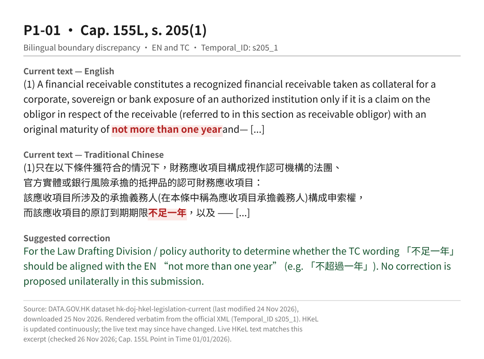

英文："not more than one year"（≤ 1 年，含整整一年）。
繁体中文：「不足一年」（< 1 年，不含整整一年）。
两版本恰好在一年这个端点上不同——繁体中文的表述比英文更严格（也比巴塞尔标准更严格，巴塞尔标准用 "less than or equal to one year" 表达同样的 ≤ 1 年界限）。只影响原始期限恰好为一年的应收款项。不单方面提出修正；提交信请律政司考虑转交法律草拟科或相关政策或监管机构处理。网上 HKeL 文本与摘录一致（2026 年 11 月 26 日核对）。

### P2-01 — Cap. 369AD, Sch. 5, Pt. 1, para. 16(5)："250 metres of more"

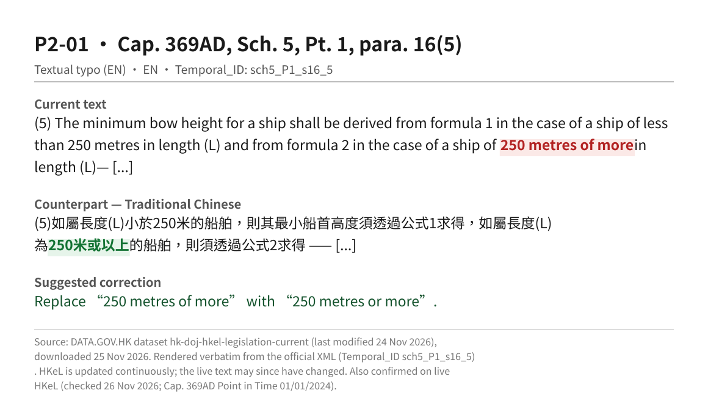

英文写的是 "250 metres of more"，应为 "250 metres or more"。平行结构（公式 1 适用于 250 米以下船舶，公式 2 适用于 250 米或以上船舶）以及正确的繁体中文「250米或以上」都证实了原意。该错误自 1997 年 6 月 30 日——本规例的原始版本——起的全部六个既往英文版本中都存在，约 29 年未改。网上 HKeL 亦已确认（2026 年 11 月 26 日核对）。

### P2-02 — Cap. 123I, s. 7A(1)(c)：两个 "(i)" 分段

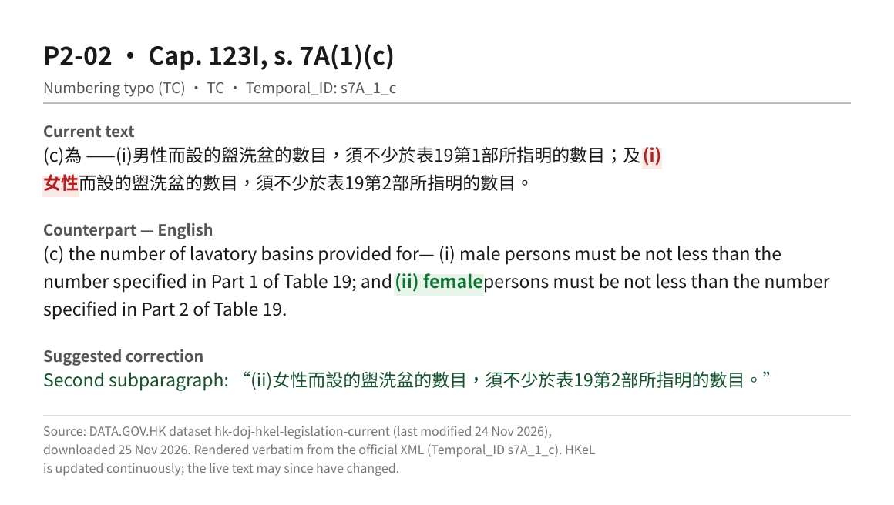

繁体中文 s. 7A(1)(c) 下的两个分段都显示 "(i)"；第二个应为 "(ii)"。英文对照正确，繁体中文 XML 的 `<num value>` 也是正确的（"ii"）——只有显示文本错了。

### P2-03 — Cap. 514, s. 144A(2)(e)：两个 "(i)" 分段

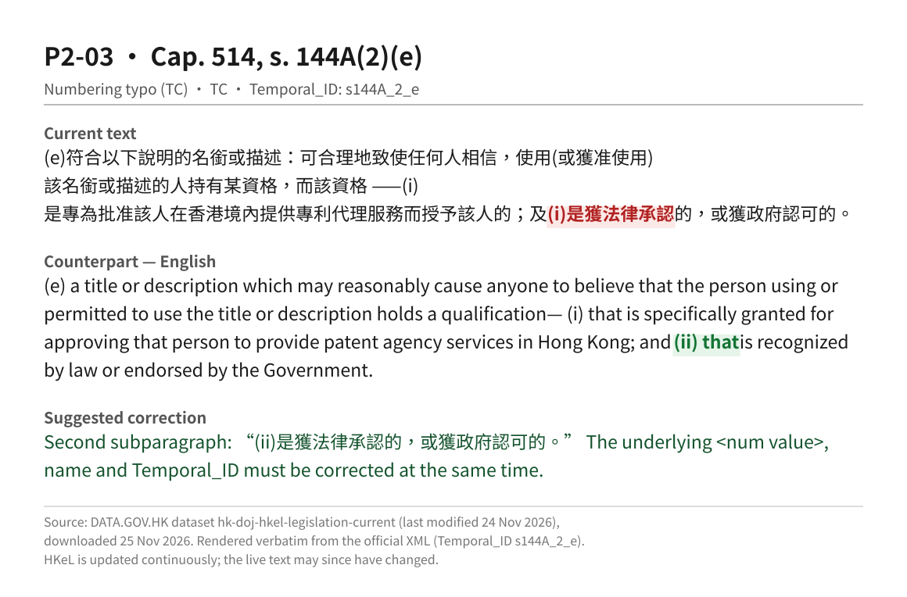

两个分段都显示 "(i)"；第二个应为 "(ii)"。此处底层 XML 元数据也错了，不只是显示文本：第二个分段的 `<num value>` 为 "1"、名称为 "1"、Temporal_ID 为 `s144A_2_e_1`，与第一个分段重复。更正时须连同元数据一起改，不只改显示文本。

### P2-04 — Cap. 374E, s. 57(3)(a)：(i), (ii), (ii)

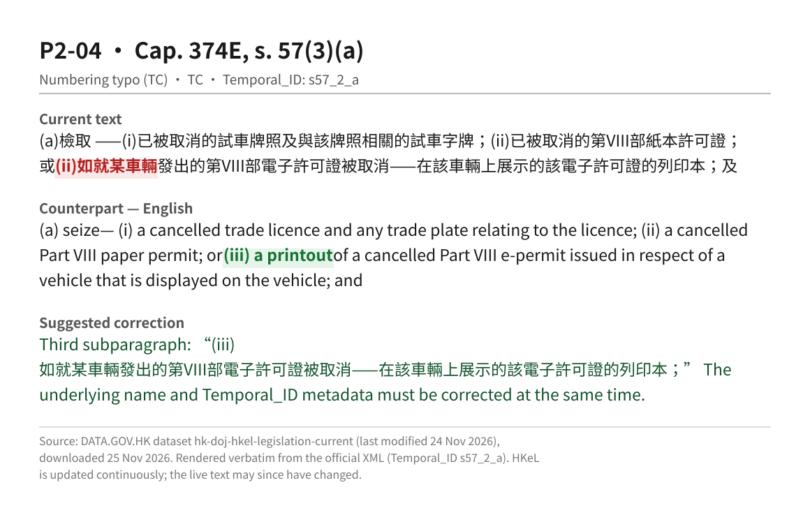

分段显示为 "(i), (ii), (ii)"；第三个应为 "(iii)"。底层 XML 元数据同样错了：第三个分段重复了第二个分段的名称（"2"）和 Temporal_ID（`s57_2_a_2`）。另请注意，s. 57(2)、s. 57(2A) 和 s. 57(3) 中的三个 (a) 段共用 Temporal_ID `s57_2_a`——这是繁体中文 XML 中的旧标识符（该款的 `<num value>` 同样是 "2"，尽管显示的编号是 "(3)"）。条文引用 s. 57(3)(a) 以显示文本为准，已对照英文 XML 核实（`s57_3_a`）。

### P2-05 — Cap. 132AK, s. 3(1) and s. 3(3)：两处都是两个 "(a)" 段

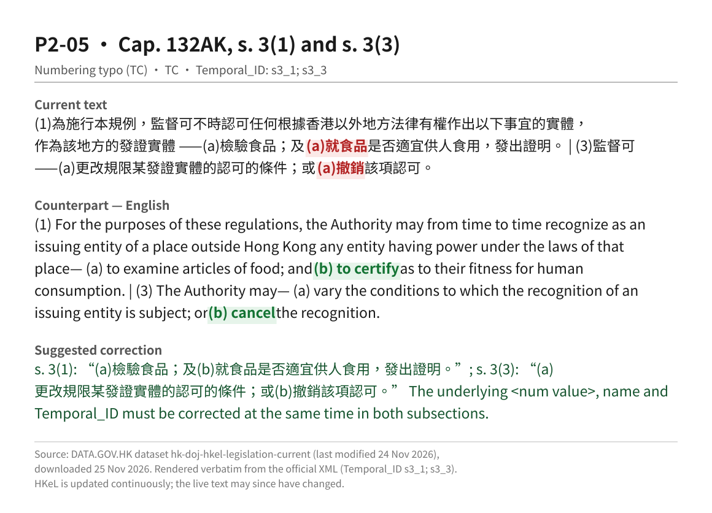

s. 3(1) 和 s. 3(3) 中，段落均显示 "(a), (a)"；每处第二个应为 "(b)"。同一条文中同一错误出现两次。底层 XML 元数据在两个款中也同样错了：第二个段落的 `<num value>` 为 "a"、名称为 "a"、Temporal_ID 为 `s3_1_a`（s. 3(1)）／`s3_3_a`（s. 3(3)），与第一个段落重复。更正时须连同元数据一起改，且两个款都要改，不只改显示文本。

### P2-06 — Cap. 511, s. 56(1)(l)：(1) 应为 (l)

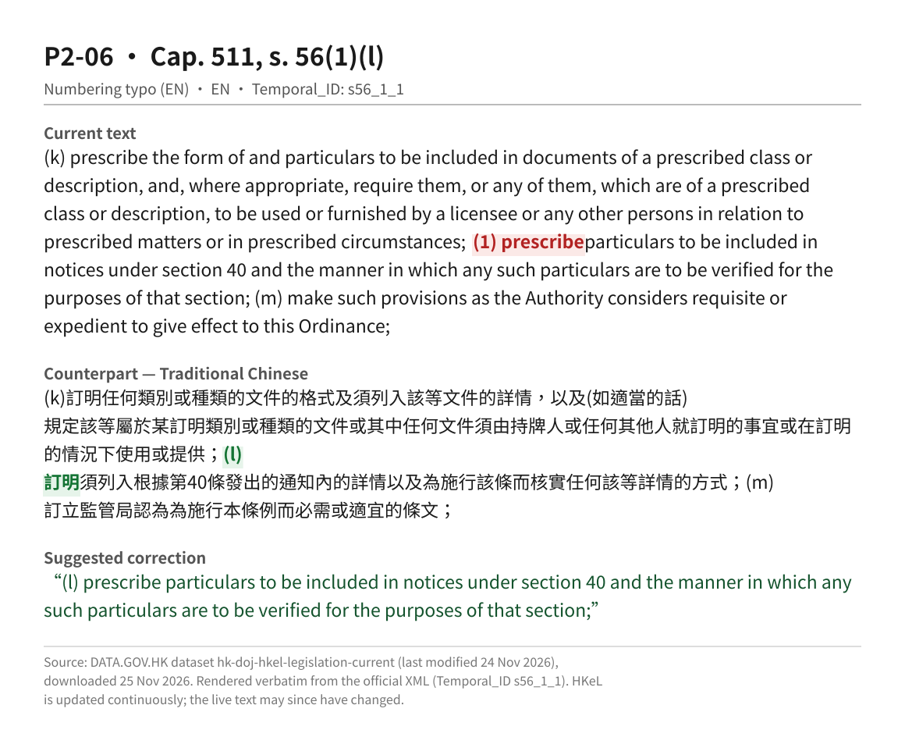

在英文 (a)–(n) 字母列表中，有一项在 "(k)" 与 "(m)" 之间显示 "(1)"（数字 1），应为 "(l)"（字母 L）。繁体中文正确显示 "(l)"。注：有缺陷段落的英文 XML Temporal_ID 为 `s56_1_1`（数字 "1"，与显示一致）；繁体中文对应段落为 `s56_1_l`。

### P2-07 — Cap. 112, s. 17A(1)：定义词条中多了一个 "("

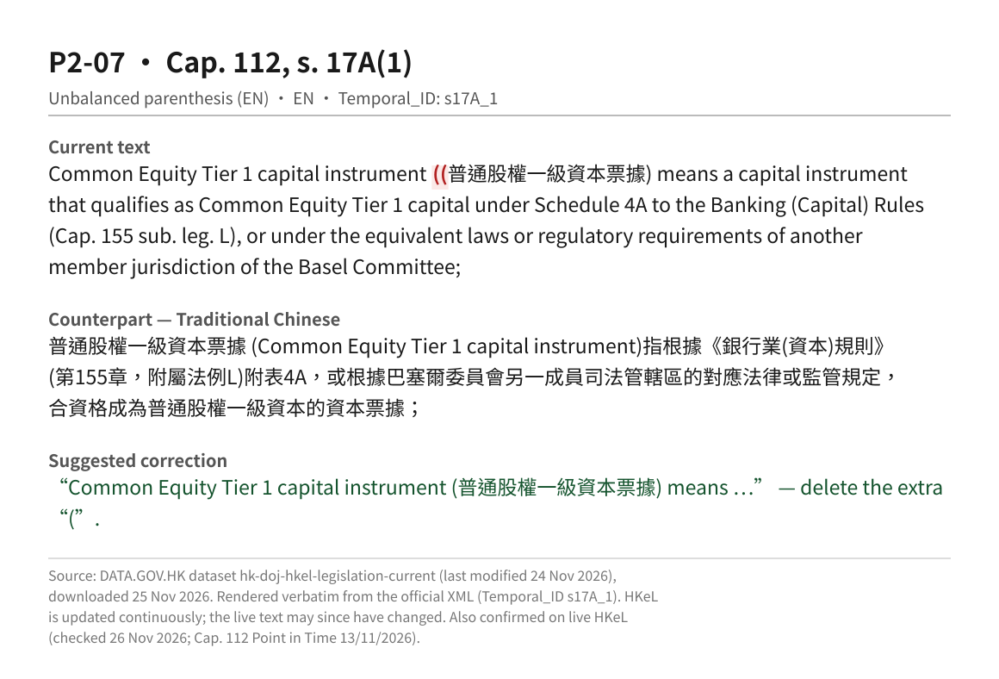

英文定义词条以两个 "(" 开头、一个 ")" 结尾："((普通股權一級資本票據)"。应为 "(普通股權一級資本票據)"。自该条文增设时起即存在（2016 年第 12 号条例第 14 条；首个版本为 2016 年 6 月 3 日），约 10 年未改。网上 HKeL 亦已确认（2026 年 11 月 26 日核对；网上版本为 2026 年 11 月 13 日）。

### P2-08 — Cap. 155S, s. 84(1)：(第571章》

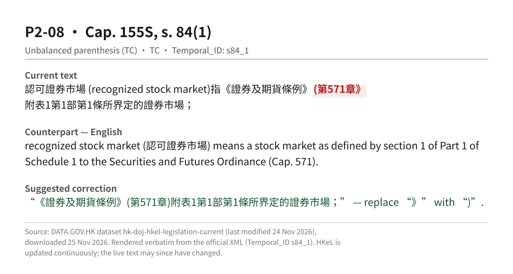

繁体中文以全角 "》" 闭合括号，而非 ")"："(第571章》"应为"(第571章)"。英文括号平衡无误。

### P2-09 — Cap. 161, Sch. 6, Pt. 1, s. 1：缺 "("

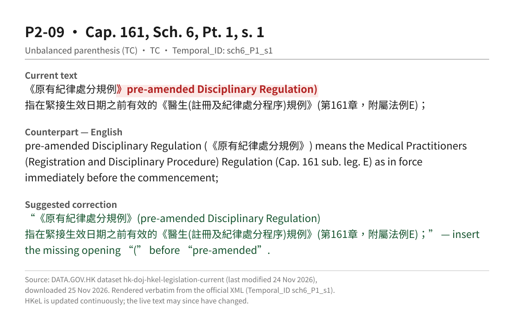

《原有紀律處分規例》的英文说明缺了左括号 "("——写成了 "pre-amended Disciplinary Regulation)"。相邻两个定义括号完整。

### P2-10 — Cap. 4A, Order 69, r. 1：多了一个 ")"

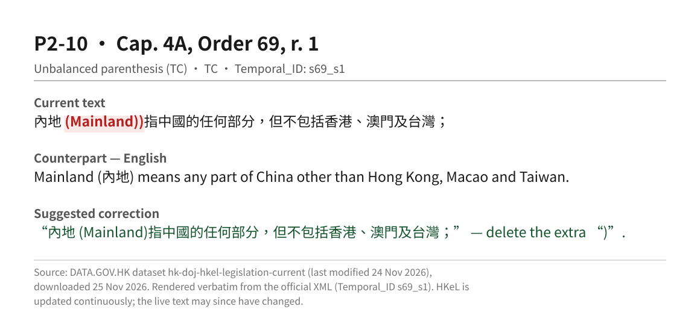

繁体中文写的是 "內地 (Mainland))"——一个 "(" 配了两个 ")"；多余的 ")" 在 `<term>` 文本 "Mainland)" 内。英文 "Mainland (內地)" 括号平衡。

### P2-11 — Cap. 622, s. 114(3)：缺 "("

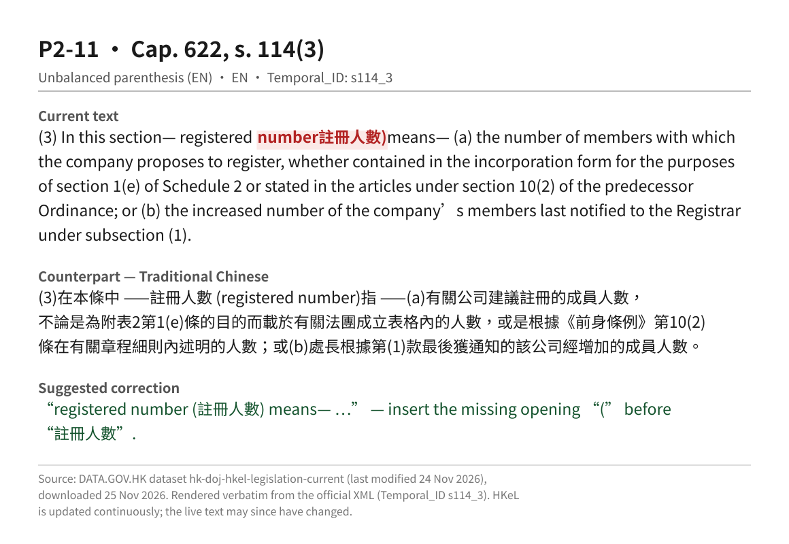

定义以 "registered number" 开头，中文说明缺了左括号 "("——写成了 "registered number註冊人數)"。应为 "(註冊人數)"。

### P2-12 — Cap. 4A, Order 117A, r. 23（标题）：缺 ")"

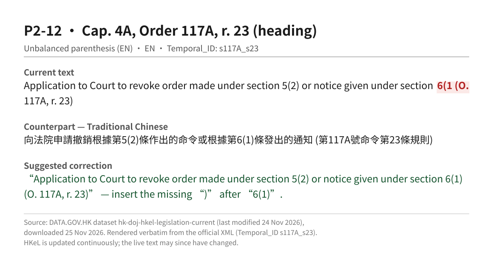

规则标题写的是 "section 6(1 (O. 117A, r. 23)"——"6(1" 缺了右括号 ")"。应为 "section 6(1)"。

### P2-13 — Cap. 136, s. 70(2)：修订注后多了一个 ")"

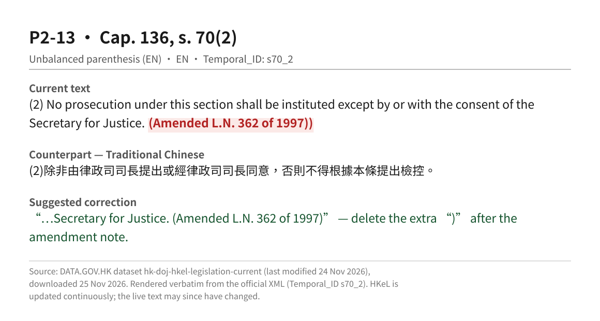

修订注之后多了一个 ")"："…Secretary for Justice. (Amended L.N. 362 of 1997))"。多余的 ")" 在修订注（本身括号平衡）之后的 `<content>` 文本里；错不在修订注本身。

### P2-14 — Cap. 374, s. 131(1)(m)：缺 "("

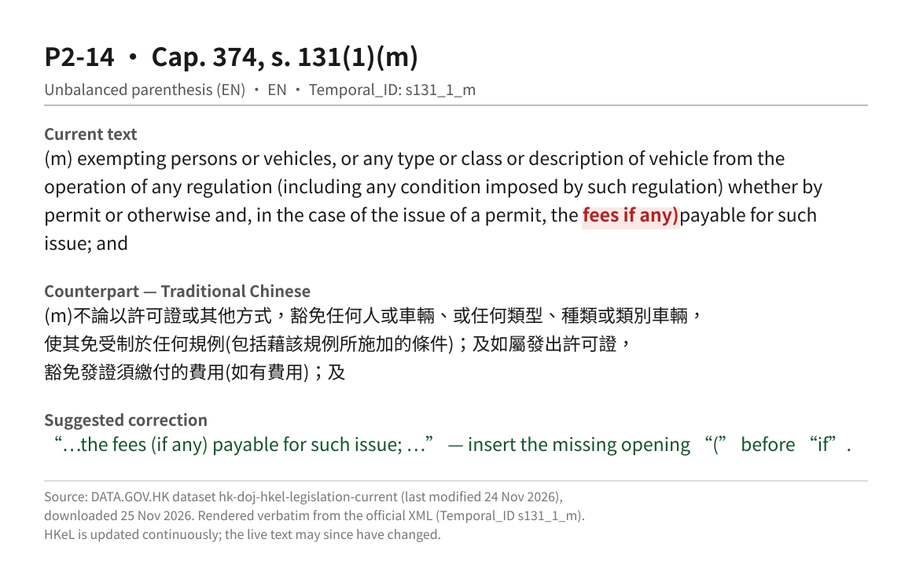

"…the fees if any) payable…"——"any" 之后有一个不成对的 ")"。缺的是 "if" 之前的左括号 "("："the fees (if any) payable"。同一段中较早的 "(including …" 括号已经闭合。

### S-01 — Cap. 571, Sch. 10, Pt. 1, s. 82(b)：(a)款应为 paragraph (a)

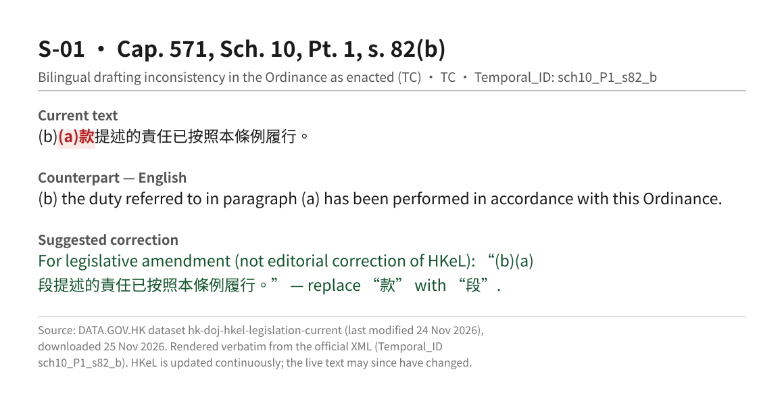

繁体中文写 "(a)款"（第 (a) 款），但 (a) 在两个 XML 版本中都是段（paragraph），英文也正确写着 "the duty referred to in paragraph (a)"。所指对象没有歧义。该措辞见于制定时的条例文本（2002 年第 5 号条例，宪报文本），不是 HKeL 转录或数字化错误：同一附表第 1 部 s. 79(c) 在类似引用中使用了「段」。因此更正须通过立法修订，而非编辑 HKeL。

## 方法

本节只介绍核对上述各条所需的方法。不随本报告发布批量数据或提取脚本。

- **来源**。DATA.GOV.HK 数据集 `hk-doj-hkel-legislation-current`（最后修改于 2026 年 11 月 24 日），2026 年 11 月 25 日下载——八个英文和繁体中文 ZIP 压缩包（四个简体中文压缩包未使用）。
- **核对**。每一条都在快照 XML 中对照同一条文的两个语言版本核对，以 `Temporal_ID` 定位；CSV 中的摘录逐字取自该 XML。只保留在现行综合文本中明确无误的条目。
- **网上抽查**。Cap. 112, s. 17A(1) 与 Cap. 369AD, Sch. 5, Pt. 1, para. 16(5) 已在网上 HKeL 确认，Cap. 155L, s. 205(1) 的网上文本已确认与快照一致（2026 年 11 月 26 日核对）。网上 HKeL 持续更新，因此任何一条的网上文本此后可能已变；本报告以快照为准。
- **复现**。打开 CSV 中的章节链接，找到所引条文；或打开 DATA.GOV.HK 上该章的 XML，搜索 CSV 中给出的 `Temporal_ID`。每一条都应能在一分钟内手工核对。
- **局限**。快照日期为 2026 年 11 月 24/25 日。P1 项是两个语言版本之间的实质差异，不是错字，不单方面提出修正。S-01 项见于制定时的条例，须立法处理，不能只改文本。

## 本仓库不包含的内容

- 提交信所列 16 项之外的一切内容。
- 除提交信本身外，与律政司的任何往来（2026 年 11 月 26 日已收到自动回执确认收件；回执不在此复现）。
- 对任何其他章节或条文的主张。

## 文件

- `HKeL_Verified_Errata_16_Final_2026-11-26.csv`——已提交的数据文件：16 项，含双语摘录、建议修正、问题说明及 XML `Temporal_ID` 定位（UTF-8 含 BOM，CRLF 换行）。
- `submission/`——提交信原文（HTML；存档时已将发件人个人邮箱脱敏，并删去发信前的提示语，正文其余内容不变）。
- `evidence/`——每项一张图片，逐字取自快照 XML 渲染，缺陷以红色标出（能证明错误的正确对照形式以绿色标出）。渲染脚本不发布；图片可对照 CSV 摘录与快照 XML 核对。

## 许可与署名

- 本报告正文以 CC BY 4.0 发布（见 `LICENSE`）。
- 证据图片与 CSV 中引用的法例文本来自 HKeL／DATA.GOV.HK，版权仍属香港特别行政区政府。此处转载仅为报告错误之用。
- 引用：周何共，《香港电子版法例（HKeL）勘误：15 项已核实的文本勘误，另加一项起草不一致》（提交香港律政司，2026 年 11 月 26 日）。仓库：https://github.com/stupidzhg/hkel-errata-2026-11
- 如对本报告有疑问，请在本仓库开 issue。

## 状态日志

- **2026 年 11 月 26 日**——提交律政司；当日收到自动回执。本仓库发布。
- 律政司回复或各条得到更正时，将在此续记。已修正的条目将标注「已修正」并注明日期，不删除。
